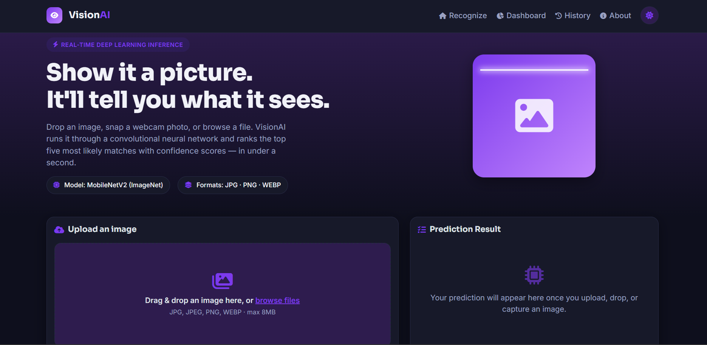
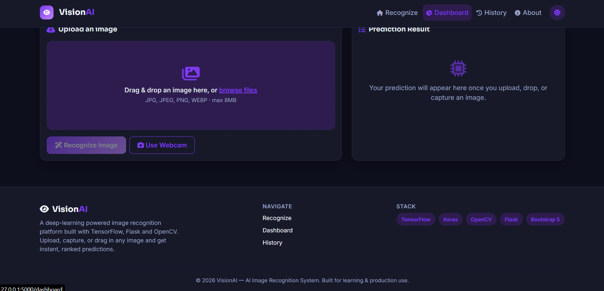
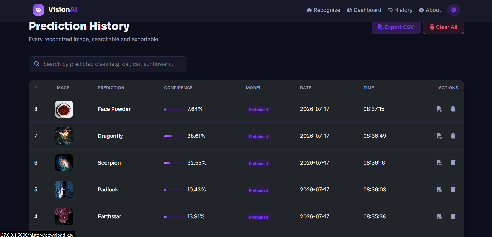
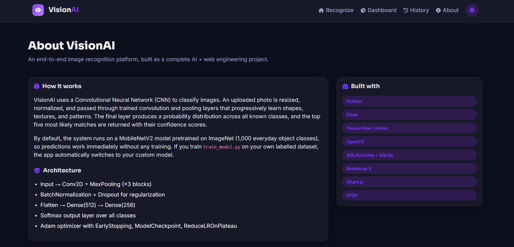
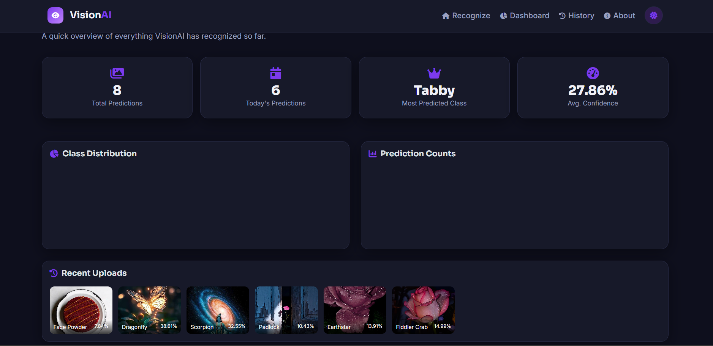

# VisionAI 

A complete, production-style image recognition web application built with **Flask**, **TensorFlow/Keras**, **OpenCV**, and **Bootstrap 5**. Upload an image, drag-and-drop it, or capture one from your webcam, and get an instant ranked prediction with confidence scores — backed by a real database, history, dashboard, and PDF/CSV exports. 
 
---  
  
## How predictions work (important) 

This repository ships with **empty** `dataset/` folders (as requested in the project spec), so there is no training data included. To make sure the app is genuinely usable the moment you install it:

- **Out of the box**, the app automatically uses a **pretrained MobileNetV2** model (trained on ImageNet, 1,000 real-world classes — including many cats, dogs, car models, and flower species). No training required. Predictions are real and accurate immediately.
- **If you want custom classes** (e.g. only your own cats/dogs/cars/flowers categories), put labelled images into the `dataset/<class_name>/` folders and run `python train_model.py`. Once `model/image_model.h5` exists, the app **automatically switches** to your custom-trained model on the next restart.

You can check which model is active on the home page (badge under the headline) or in `logs/app.log`.

---

## Project Structure

```
AI_Image_Recognition_System/
├── app.py                  # Main Flask application & routes
├── predict.py               # Model loading + inference logic
├── train_model.py            # CNN training script for custom datasets
├── config.py                  # App configuration
├── database.py                 # SQLAlchemy setup
├── models.py                    # Prediction DB model
├── utils.py                      # Helpers: validation, CSV/PDF export, logging
├── requirements.txt
├── README.md
│
├── model/
│   ├── image_model.h5        # Created after training (not included by default)
│   └── class_names.pkl       # Created after training (not included by default)
│
├── dataset/
│   ├── cats/                 # Add your own images here to train
│   ├── dogs/
│   ├── cars/
│   └── flowers/
│
├── uploads/                  # Uploaded images are stored here
├── history/                  # SQLite database file
├── reports/                  # Generated PDF/CSV reports
├── logs/                      # Rotating app logs
│
├── static/
│   ├── style.css
│   ├── script.js
│   └── logo.png
│
└── templates/
    ├── base.html
    ├── index.html
    ├── result.html
    ├── history.html
    ├── dashboard.html
    ├── about.html
    ├── 404.html
    └── 500.html
```

---

## 1. A note on webcam capture & OpenCV

For a web application, the **browser** owns camera access (via `getUserMedia`) — a Flask server has no way to reach into a visitor's laptop and open their camera directly, and trying to do so server-side with `cv2.VideoCapture` would only ever access the *server's* camera, not the user's. So webcam capture here is implemented in JavaScript (`static/script.js`), which snaps a frame and uploads it to the same prediction pipeline as a normal file.

OpenCV (`cv2`) is still used server-side where it actually belongs: validating that uploaded files are genuine, decodable images (as a second check alongside Pillow) and reading image dimensions in `utils.py`.

---


### Step 2 — Create a virtual environment

```bash
python -m venv venv

# Activate it
venv\Scripts\activate        # Windows
source venv/bin/activate     # macOS / Linux
```

### Step 3 — Install dependencies

```bash
pip install -r requirements.txt
```

> First install downloads TensorFlow (~500MB) — this can take a few minutes.

### Step 4 — Run the app

```bash
python app.py
```

Open your browser at:

```
http://127.0.0.1:5000
```

The first request will download MobileNetV2's pretrained weights (~14MB) automatically via Keras — this requires an internet connection the very first time only; weights are then cached locally by Keras (`~/.keras/models`).

---

## 3. Training your own model (optional)

1. Add images into the matching sub-folder, e.g.:
   ```
   dataset/cats/cat_001.jpg
   dataset/dogs/dog_001.jpg
   dataset/cars/car_001.jpg
   dataset/flowers/flower_001.jpg
   ```
   Use at least 2 populated class folders with a reasonable number of images each (50+ per class recommended for decent accuracy).

2. Run the training script:
   ```bash
   python train_model.py
   ```

3. The script will:
   - Apply data augmentation (rotation, zoom, flips, shifts)
   - Train a CNN (Conv2D ×3 → BatchNorm → Dropout → Dense(512) → Dense(256) → Softmax)
   - Use EarlyStopping, ModelCheckpoint, and ReduceLROnPlateau
   - Save `model/image_model.h5` and `model/class_names.pkl`
   - Save an accuracy/loss graph to `model/training_history.png`

4. Restart `python app.py` — it will detect and load your custom model automatically.

---

## 4. Features

- Upload via click-to-browse, drag-and-drop, or webcam capture
- Top-5 predictions with confidence bars
- Persistent SQLite history (filename, prediction, confidence, date, time)
- Search history by predicted class
- Delete individual records or clear all history
- Export history to CSV
- Generate a per-prediction PDF report
- Dashboard with total/today's predictions, most-predicted class, average confidence, pie chart, and bar chart
- Dark mode toggle (persisted across sessions)
- Fully responsive Bootstrap 5 UI (desktop, tablet, mobile)
- File-type and corrupted-image validation, with flash messages
- Custom 404 / 500 error pages
- Rotating file + console logging

---

## 5. Deployment

### Render
1. Push this project to a GitHub repository.
2. Create a new **Web Service** on [Render](https://render.com), connect your repo.
3. Build command: `pip install -r requirements.txt`
4. Start command: `gunicorn app:app`
5. Add a persistent disk if you want uploads/history to survive restarts.

### Railway
1. Create a new project on [Railway](https://railway.app) from your GitHub repo.
2. Railway auto-detects Python; set the start command to `gunicorn app:app`.
3. Add environment variable `PORT` is provided automatically by Railway — update `app.py`'s `app.run()` line to use `os.environ.get("PORT", 5000)` for production, or rely on the Procfile/gunicorn binding.

### PythonAnywhere
1. Upload the project files (or `git clone` your repo) via a Bash console.
2. Create a virtualenv and `pip install -r requirements.txt`.
3. Configure a new Flask web app pointing to `app.py`, with the working directory set to the project root.
4. Reload the web app from the dashboard.

---

## 6. Tech Stack

| Layer | Technology |
|---|---|
| Backend | Python, Flask |
| ML / CV | TensorFlow, Keras, OpenCV, NumPy, Pillow |
| Database | SQLite via SQLAlchemy |
| Frontend | HTML5, CSS3, Bootstrap 5, JavaScript, Chart.js |
| Reports | FPDF (PDF), CSV |
| Deployment | Render / Railway / PythonAnywhere, Gunicorn |

---

## 7. Screenshots

>  screenshots after running the app locally:

## 📸 Project Screenshots

### 🏠 Home Page


---

### 📊 Dashboard


---

### 📜 History Page


---

### ℹ️ About Page


---

### 🌟 Overview



## 8. Notes & Limitations

- Maximum upload size is 8MB (configurable in `config.py`).
- Allowed formats: JPG, JPEG, PNG, WEBP.
- This is an educational / portfolio-grade project. For production traffic at scale, move uploads to object storage (e.g. S3) and the database to PostgreSQL.

---

Built as a complete AI + full-stack web development project.
